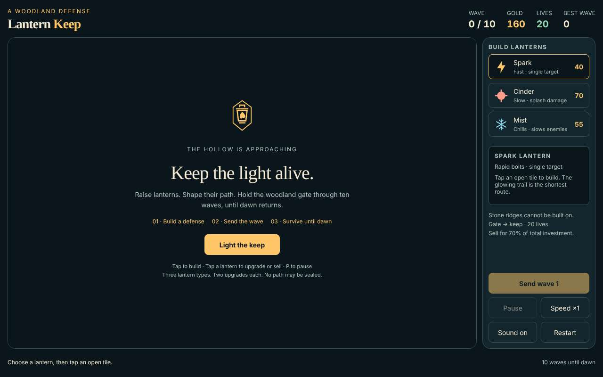
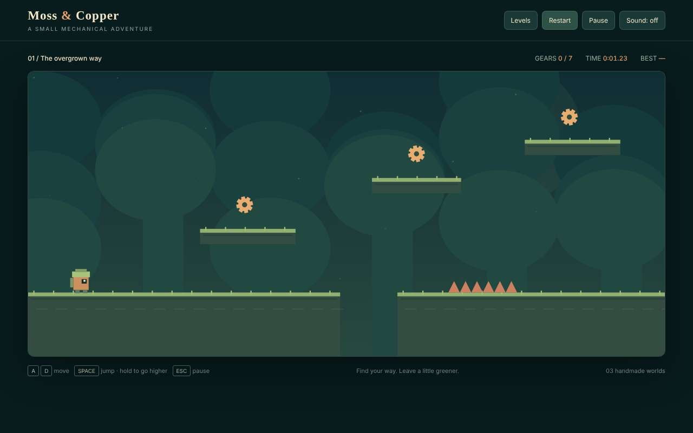

# Hard ten: results

Rules, written before the first build: [RULES.md](RULES.md). Each build's final files are in [builds/](builds/).
Running total of the test is kept at the bottom.

## G1 Lantern Keep (tower defense, Ghost Gamer): **passed, 4 of 4**

14 minutes · 4 rounds · 6 commits · **$2.08** of its $4.

| Item | Result |
|---|---|
| 1. Checks | **Pass.** Last check passed on the final commit (`c00000d`). Its first check had failed; fixed in round 2. |
| 2. Browser | **Pass.** Ghost Code's browser check on the final commit: no console errors, no failed requests, no blank page, no sideways scroll; it opened the menu 3 times and clicked once. |
| 3. Own tests, covering the hard part | **Pass.** 10 of 10 pass (`npm test`). They cover A* routing around rocks and towers, and that a placement that would block every path is refused without taking gold. Also upgrades and the 70% sell, the wave schedule (only wave 10 has a boss), gold per kill. |
| 4. Hard part, by hand | **Pass.** We walled off a whole column tower by tower: 9 placed, the 10th refused with "Cannot build: this would block every path to the keep." The path went from 16 to 26 steps, every step one grid move apart and around the towers. |

**The second reviewer ran inside this build** (round 3), for the first time in a real build since it was added. It
raised 2 points:
- *The placement preview colours are inverted.* **Wrong:** `canPlace()` returns `null` for an allowed tile, and the
  code shows null as gold, a refusal as red, which is right. The builder did not change the code: it wrote a test
  that draws the preview and checks gold for an allowed tile and red for a refused one (it passes). Answered with
  evidence, not with words.
- *Hit effects from the last kill of a wave never expire.* **Right.** Fixed in `game-core.js`, with three tests
  (between waves, after winning, after losing).

So: one false alarm, disproved by a test; one real bug, fixed with tests. Not played for fun; not tried on a phone.

## G2 Moss & Copper (platformer, Ghost Gamer): **passed, 4 of 4**

14 minutes · 4 rounds · 9 commits · **$1.46** of its $4.

| Item | Result |
|---|---|
| 1. Checks | **Pass.** Last check passed on the final commit (`c000015`). |
| 2. Browser | **Pass.** No console errors, failed requests, blank page or sideways scroll; it clicked "Begin the journey" and "Choose a world", and both worked. |
| 3. Own tests, covering the hard part | **Pass.** 14 of 14 pass. They are about exactly the hard part: a swept collision that catches a thin floor at falling speeds up to 60,000 px/s, ceilings and walls at speed, no false landing beside a platform, standing still for 600 steps; coyote time and jump buffering at 100 ms (in real steps: a coyote jump works at step 6 and not at 7); a held jump higher than a tap; wall slide and wall jump. The tests run the game's own physics code, read out of `index.html`. |
| 4. Hard part, by hand | **Pass.** A four-second fall, accelerating, onto a 2-pixel ledge: it lands on top (y 4964 for a 36-px player on a ledge at 5000), it doesn't pass through. The game runs a fixed 1/60 s step. Three levels as data ("The overgrown way", "The fernworks", "The copper canopy"), moving platforms, checkpoints, gears, level select, best times saved, and on-screen left / right / jump buttons on a phone. |

The second reviewer ran and found no problems. Not played to the end; not tried on a real phone.

