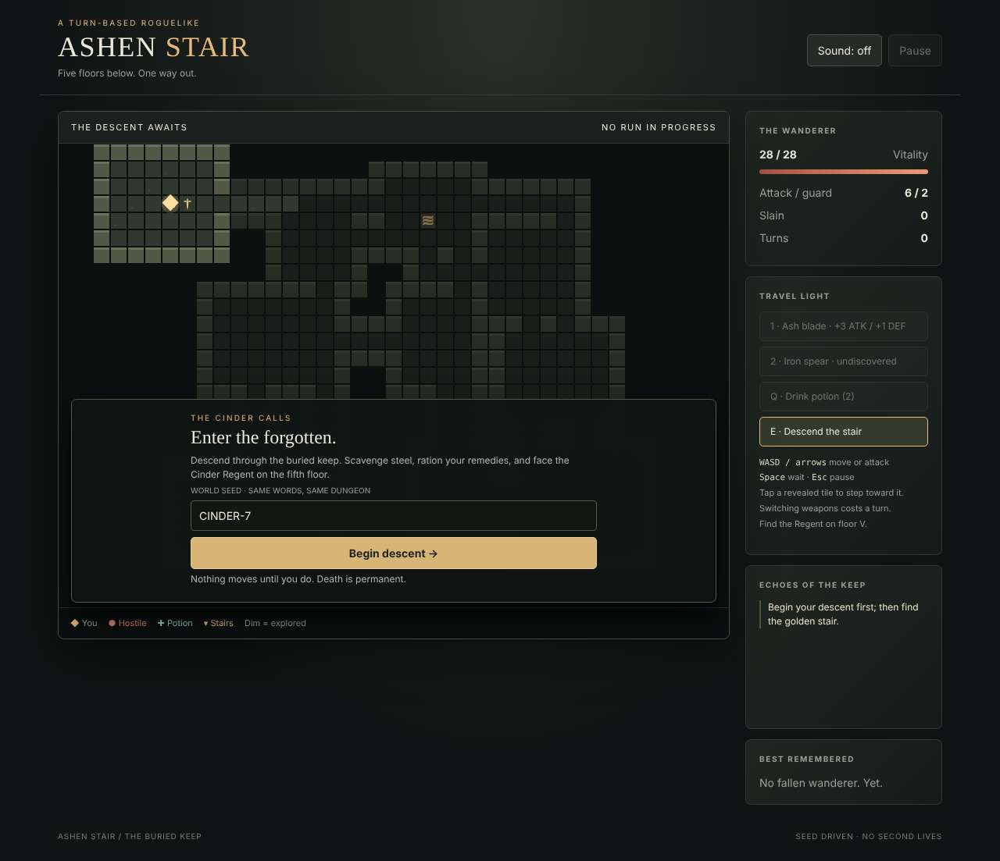
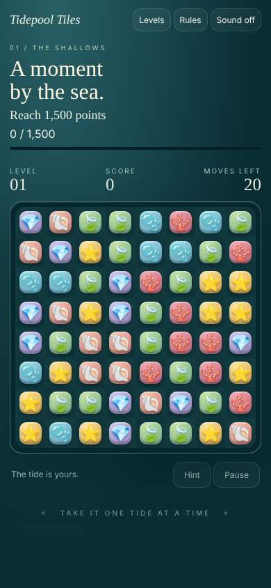
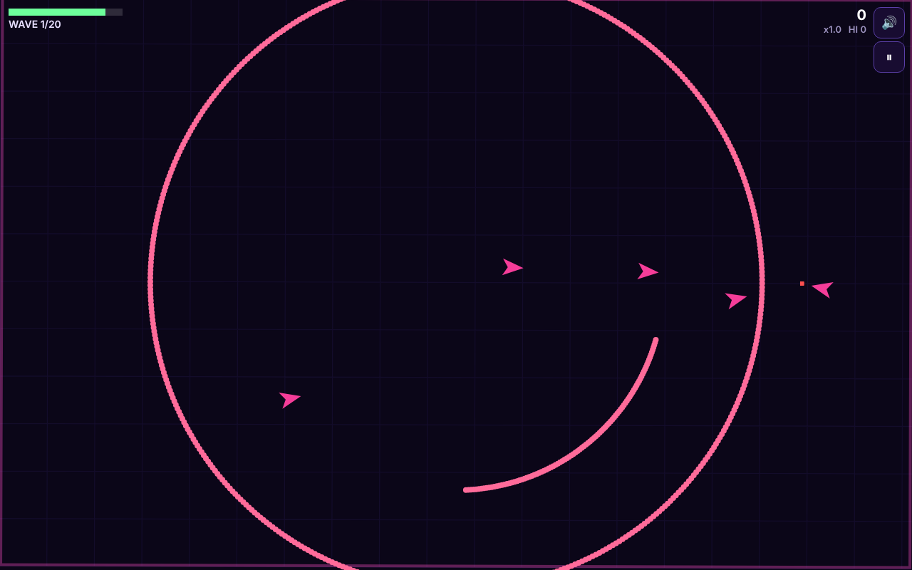
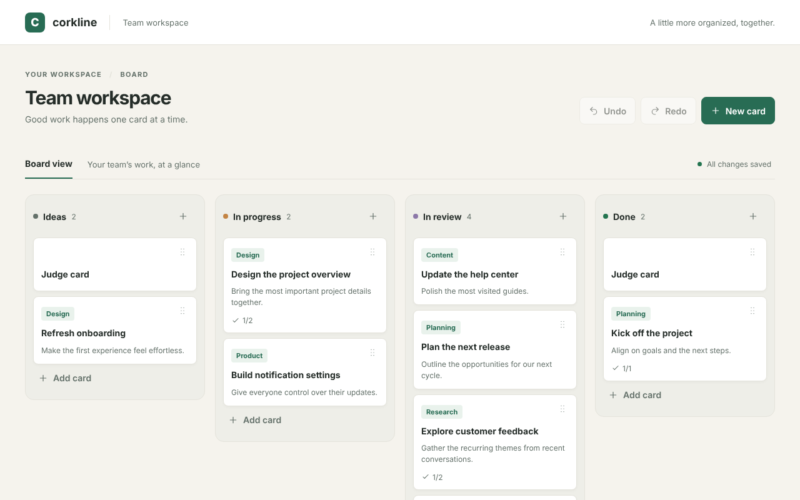
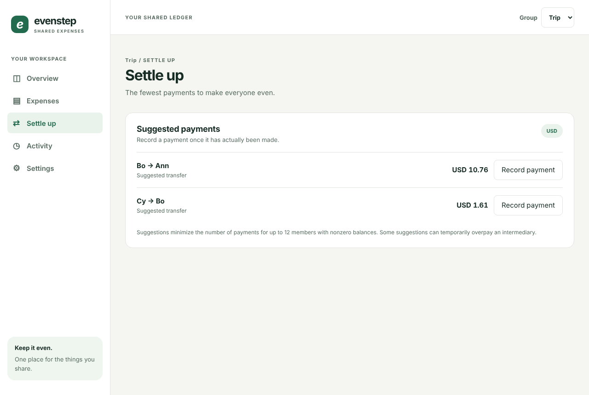
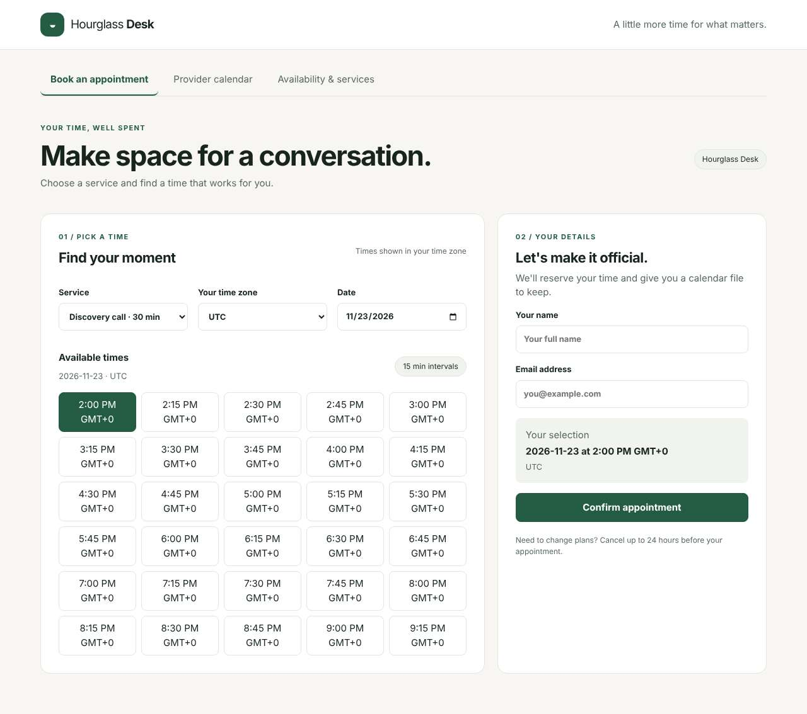
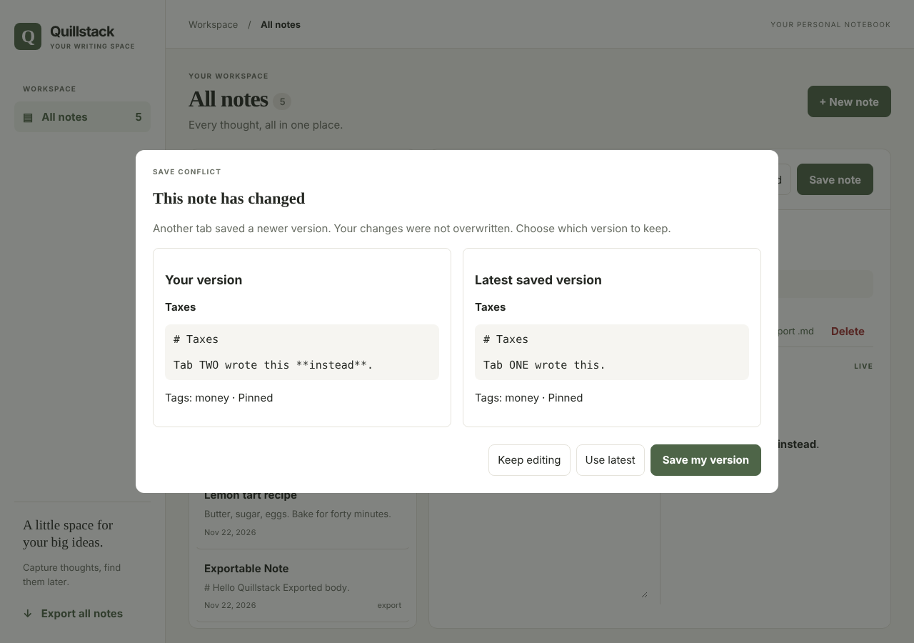
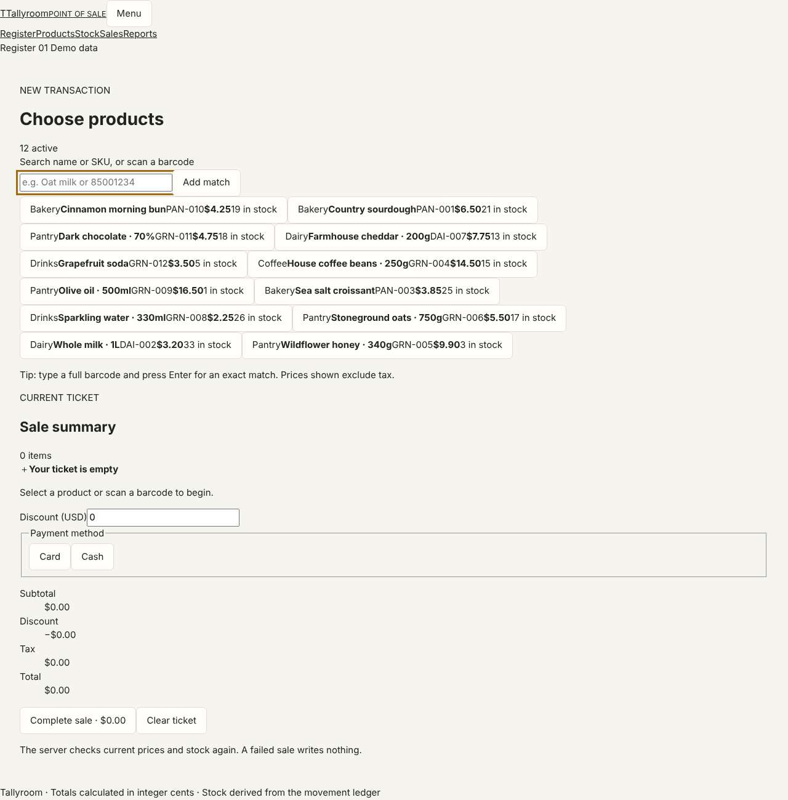

# Hard ten: results

## The result: 6 of 10 passed all four points

November 22, 2026. Ten builds from empty repositories, one task each, judged by the [rules written beforehand](RULES.md).
The test's bill: **$18.41** of the $42 allowed; no build reached its $4 limit (the dearest was $3.06).

| # | Build | Checks | Browser | Own tests | Hard part by hand | Result | Cost |
|---|---|---|---|---|---|---|---|
| G1 | Lantern Keep, tower defense | ✅ | ✅ | ✅ | ✅ | **Passed** | $2.08 |
| G2 | Moss & Copper, platformer | ✅ | ✅ | ✅ | ✅ | **Passed** | $1.46 |
| G3 | Ashen Stair, roguelike | ✅ | ✅ | ✅ | ✅ | **Passed** | $1.74 |
| G4 | Tidepool Tiles, match-3 | ✅ | ✅ | ✅ | ✅ | **Passed** | $1.35 |
| G5 | Static Bloom, arena shooter | ✅ | ✅ | ✅ | ✅ | **Passed** | $2.25 |
| A1 | Corkline, kanban | ✅ | ❌ | ✅ | ✅ | 3 of 4 | $1.28 |
| A2 | Evenstep, shared expenses | ✅ | ❌ | ✅ | ✅ | 3 of 4 | $1.91 |
| A3 | Hourglass Desk, booking | ✅ | ✅ | ❌ | ✅ | 3 of 4 | $1.84 |
| A4 | Quillstack, notes | ✅ | ✅ | ✅ | ✅ | **Passed** | $1.30 |
| A5 | Tallyroom, point of sale | ✅ | ✅ | ❌ | ✅ | 3 of 4, unfinished | $3.06 |

**Every one of the ten got its named hard part right when we tried it by hand.** That is the column we expected to
be the worst.

What the four misses were:

- **A1 and A2 (browser):** mostly our own tools. Our test machine ran their browser check without a database, and
  Ghost Code's check then raised false alarms when we ran it properly (drag handles and a required form field
  counted as dead buttons). A2 has nothing wrong that we found. A1 has one real flaw: a status label built as a
  button that does nothing.
- **A3 (tests):** real. It has no tests, and its closing message says it has.
- **A5 (tests, and unfinished):** real. 4 of its 11 tests fail, and it ran out of steps with the report page, the
  receipt and the styling not committed.

### Against what we said beforehand

| We said | What happened |
|---|---|
| The apps will do worse than the games | **Right.** Games 5 of 5, apps 1 of 5. |
| Most games will miss at least one named hard part | **Wrong.** None did. |
| A pass on more than five of ten would surprise us | **It did:** six. |

### What we could not check

No phone was tried. Nothing was played for fun: a game that passes here is correct, not necessarily good. Our test
machine is a stand-in for GitHub, and for builds 6 and 7 it ran the browser check without a database (our fault,
said in those two results). The second review ran on six builds (the five games and A4); on A1 to A3 a fault in
Ghost Code skipped it (fixed since), and A5 never reached an ending.

### What the test changed in Ghost Code

Nine gaps were found in Ghost Code itself and six are fixed (table at the end of this page). The test ran Ghost
Code as it was when the test started, so none of those fixes helped a build here.

---

Each build's final files are in [builds/](builds/). The ten results follow in the order they ran.

## G1 Lantern Keep (tower defense, Ghost Gamer): **passed, 4 of 4**

14 minutes · 4 rounds · 6 commits · **$2.08** of its $4.

| Item | Result |
|---|---|
| 1. Checks | **Pass.** Last check passed on the final commit (`c00000d`). Its first check had failed; fixed in round 2. |
| 2. Browser | **Pass.** Ghost Code's browser check on the final commit: no console errors, no failed requests, no blank page, no sideways scroll; it opened the menu 3 times and clicked once. |
| 3. Own tests, covering the hard part | **Pass.** 10 of 10 pass (`npm test`). They cover A* routing around rocks and towers, and that a placement that would block every path is refused without taking gold. Also upgrades and the 70% sell, the wave schedule (only wave 10 has a boss), gold per kill. |
| 4. Hard part, by hand | **Pass.** We walled off a whole column tower by tower: 9 placed, the 10th refused with "Cannot build: this would block every path to the keep." The path went from 16 to 26 steps, every step one grid move apart and around the towers. |

**The second reviewer ran inside this build** (round 3), for the first time in a real build since it was added. It
raised 2 points:
- *The placement preview colours are inverted.* **Wrong:** `canPlace()` returns `null` for an allowed tile, and the
  code shows null as gold, a refusal as red, which is right. The builder did not change the code: it wrote a test
  that draws the preview and checks gold for an allowed tile and red for a refused one (it passes). Answered with
  evidence, not with words.
- *Hit effects from the last kill of a wave never expire.* **Right.** Fixed in `game-core.js`, with three tests
  (between waves, after winning, after losing).

So: one false alarm, disproved by a test; one real bug, fixed with tests. Not played for fun; not tried on a phone.

## G2 Moss & Copper (platformer, Ghost Gamer): **passed, 4 of 4**

14 minutes · 4 rounds · 9 commits · **$1.46** of its $4.

| Item | Result |
|---|---|
| 1. Checks | **Pass.** Last check passed on the final commit (`c000015`). |
| 2. Browser | **Pass.** No console errors, failed requests, blank page or sideways scroll; it clicked "Begin the journey" and "Choose a world", and both worked. |
| 3. Own tests, covering the hard part | **Pass.** 14 of 14 pass. They are about exactly the hard part: a swept collision that catches a thin floor at falling speeds up to 60,000 px/s, ceilings and walls at speed, no false landing beside a platform, standing still for 600 steps; coyote time and jump buffering at 100 ms (in real steps: a coyote jump works at step 6 and not at 7); a held jump higher than a tap; wall slide and wall jump. The tests run the game's own physics code, read out of `index.html`. |
| 4. Hard part, by hand | **Pass.** A four-second fall, accelerating, onto a 2-pixel ledge: it lands on top (y 4964 for a 36-px player on a ledge at 5000), it doesn't pass through. The game runs a fixed 1/60 s step. Three levels as data ("The overgrown way", "The fernworks", "The copper canopy"), moving platforms, checkpoints, gears, level select, best times saved, and on-screen left / right / jump buttons on a phone. |

The second reviewer ran and found no problems. Not played to the end; not tried on a real phone.

## G3 Ashen Stair (roguelike, Ghost Gamer): **passed, 4 of 4**

20 minutes · 5 rounds · 10 commits · **$1.74** of its $4.

| Item | Result |
|---|---|
| 1. Checks | **Pass.** Last check passed on the final commit (`c00001a`). |
| 2. Browser | **Pass.** No console errors, failed requests, blank page or sideways scroll; "Sound" and "Begin descent" both worked. |
| 3. Own tests, covering the hard part | **Pass.** 6 of 6 pass. 250 seeds × 5 floors all fully connected with the stairs reachable; the same seed gives the same floor, monsters and loot; line of sight stops at the first wall; combat math (defense subtracted, at least 1 damage, whole numbers). The tests run the game's own rules, read out of `index.html`. |
| 4. Hard part, by hand | **Pass.** With our own reachability check (not the build's), 2,000 random seeds across floors 1 to 5: **0** floors with an unreachable tile or unreachable stairs, and **2,000 of 2,000** identical when generated again from the same seed. Four monster kinds (Cinder rat, Ash wraith, Iron husk, Ember knight) and the boss, the Cinder Regent, on floor 5. Fog of war ("dim = explored"), potions and two weapons, tap-to-move, best run saved. |

The second reviewer ran and found no problems. Not played to the end; not tried on a real phone.

## G4 Tidepool Tiles (match-3, Ghost Gamer): **passed, 4 of 4**

12 minutes · 4 rounds · 9 commits · **$1.35** of its $4.

| Item | Result |
|---|---|
| 1. Checks | **Pass.** Last check passed on the final commit (`c000013`). |
| 2. Browser | **Pass.** No console errors, failed requests, blank page or sideways scroll; it clicked Levels, Rules, Sound and five tiles, and all worked. |
| 3. Own tests, covering the hard part | **Pass.** 13 of 13 pass: 100 seeds start with no match and a move; matches don't wrap across rows; a swap that makes no match rolls back exactly; cascades keep the order of surviving tiles and settle; 4 makes a line tile and 5 a colour bomb, each firing when matched or swapped, two bombs clearing the board; "no move left" reshuffles to a playable board; a long seeded game stays full and playable. The board logic is its own file (`engine.js`), and a test checks the page embeds exactly that file. |
| 4. Hard part, by hand | **Pass.** We played 300 seeded boards for 40 moves each (12,000 moves): **0** boards started with a match or with no move, and **0** ended a move with a gap, an unsettled match or no move left. 12 levels with goals (score, or tiles of a kind) and a move limit; stars; progress saved. |

Small things: a second copy of the screenshot check file was left in the repository's root (`ghost-screenshots.yml`; harmless, not a check GitHub runs). The tiles are emoji. The second reviewer ran and found no problems.

## G5 Static Bloom (arena shooter, Ghost Gamer): **passed, 4 of 4, with a finding about our own check**

12 minutes · 4 rounds · 11 commits · **$2.25** of its $4.

| Item | Result |
|---|---|
| 1. Checks | **Pass.** Last check passed on the final commit (`c000019`). On the way, two fixes made things worse (errors 1 → 1, then 1 → 4) and Ghost Code undid both by itself. |
| 2. Browser | **Pass, run by us afterwards.** This repository never got Ghost Code's own browser check (see the finding below), so our test machine did not run it during the build. We ran it on the final commit ourselves: no console errors, failed requests, blank page or sideways scroll; "Start" worked (the sound button could not be pressed while the start screen covers it). The build's own Chromium test also passes here. |
| 3. Own tests, covering the hard part | **Pass.** 12 of 12: collisions (a fast bullet that would skip over a target is caught by a segment test; shields block from the front only), the wave schedule (20 waves, bosses on 5/10/15/20 only, all 4 kinds), and the pool (hands out at most its size and reuses objects). |
| 4. Hard part, by hand | **Pass.** With 500 bullets alive in a real browser, 240 frames: median 16.7 ms, worst 16.8 ms (60 frames a second, steady; headless Chromium on our machine, not a phone). Bullets, particles, enemies and pickups come from fixed pools made up front; we found no object creation in the simulation loop. Shake from a "trauma" value, hit-stop, and a reduced-motion setting that turns both off are in the code. |

**The second reviewer ran and raised 3 points; the builder changed code for all three**, with tests: a new object made during play (against "no new objects inside the loop"), a win that could overwrite a fatal hit's game over, and a touch stick that slowed down when dragged past its edge.

### A finding about Ghost Code itself, from the five games

Ghost Code adds its own browser check (a long, fixed file) to a web app's first commit. It decides "this is a web
app" from the request's words, and **"web game" and "HTML canvas" are not among them**. So only G1 (whose brief says
"one HTML page") got the real file. In G2, G3 and G4 the builder wrote a short check file of its own under the same
name; in G5 there is none.

What this means for the results above: our test machine runs Ghost Code's real browser script for any check named
"Ghost Screenshots", so the browser results for G1 to G4 are from the real script, and G5's is from us running it
afterwards. **On real GitHub, the repositories of G2, G3 and G4 would run the builder's own browser test instead,
and G5's would run only its own tests.** The games are not worse for it; our check was simply not there. To be
fixed in Ghost Code after this test (the five apps say "web app" and are not affected).

## A1 Corkline (kanban, Ghost Coded): **3 of 4. The app works; the browser item does not pass, and our own tools are part of why**

20 minutes · 6 rounds · 8 commits · **$1.28** of its $4. The second reviewer did not run: the builder ended with two
of its own list items still open ("fix issues discovered", "run checks and inspect"), and the review only runs when
the list is done.

| Item | Result |
|---|---|
| 1. Checks | **Pass.** Last check passed on the final commit (`c000011`). |
| 2. Browser | **Not passed.** Two things happened, both worth more than the verdict. See below. |
| 3. Own tests, covering the hard part | **Pass.** 6 of 6, with a real Postgres: moves within and between columns, undo and redo (a new edit clears redo), the database refusing the same change twice, the offline queue sending changes once and in order, and a failed request staying queued with the same id. |
| 4. Hard part, by hand | **Pass.** With a real database: the same change sent twice makes one card, and sent five times at the same moment makes one card. In a real browser: a card dragged by its handle is stored on the server; Ctrl+Z puts it back on the server; a drag made offline does not reach the server, and arrives once when back online; no console errors. |

**Item 2, what happened.**

1. *Our test machine's fault.* During the build, our machine ran the browser check **without a database** for the
   app (the real check starts one). So every picture the builder was shown, and the final one, is the app saying
   "Could not load board. Check the database connection." ([as checked](builds/a1-kanban-as-checked.jpg)). The
   check passed anyway, and the builder called the work done having looked at that screen twice. From build 8 on,
   our machine gives the app a database; **builds 6 and 7 ran without one.**
2. *A gap in Ghost Code's check.* A check that is green on "Could not load board" is wrong: the app's own server
   answered 503 on every screen, and the check lists that as a warning. To be fixed.
3. *Run again by us with a database*, Ghost Code's real check **fails** this build: "these buttons do nothing when
   pressed". Three of the four are drag handles (pressing a handle is not how it is used: **a false alarm in our
   check**, to be fixed) and one is the "All changes saved" status, built as a button that does nothing (a small,
   real flaw in the app). No console errors, no failed requests, the board loads.

By the letter of the rules that is a fail on item 2, so 3 of 4. In plain words: the app does what the brief's hard
part asks, and the parts of this result that are wrong are mostly ours.

### Three more findings about Ghost Code and our test, from this build

- Our test machine did not give an app's server a database during the browser check (fixed from build 8).
- Ghost Code's browser check passes when the app's own server answers 5xx on its first screen. It should fail.
- Ghost Code's browser check counts a drag handle as "a button that does nothing". It should not press handles.

## A2 Evenstep (shared expenses, Ghost Coded): **3 of 4 by the letter. We found nothing wrong with the app; the browser item fails on a false alarm in our check**

19 minutes · 6 rounds · 13 commits (three of them Ghost Code undoing a fix that didn't lower the error count) ·
**$1.91** of its $4. The second reviewer did not run, for the same reason as A1: the builder ended with two of its
own list items still open.

| Item | Result |
|---|---|
| 1. Checks | **Pass.** Last check passed on the final commit (`c000018`). The test job failed three times on the way and passed on the fourth. |
| 2. Browser | **Not passed.** During the build it was green, but on an error screen (our machine gave it no database, as with A1). Run again by us with a database it fails on one thing, and that thing is a false alarm. See below. |
| 3. Own tests, covering the hard part | **Pass.** 6 of 6, with a real Postgres: equal, exact and percentage splits that keep every cent; conversion at a rate; the fewest payments, checked against an exhaustive answer for every group of up to five people with balances from -3 to 3; unbalanced input and groups over 12 people refused; the same expense sent twice stored once. |
| 4. Hard part, by hand | **Pass.** Through the running server with a real database: $10.00 three ways is stored as 334 + 333 + 333 cents; 5,000 random equal splits never lost or invented a cent; percentages that don't add to 100 and exact shares that don't add to the total are refused; an amount with more than two decimals is refused (no floats anywhere: amounts are whole cents as big integers, rates are a fraction); EUR 7.00 at 1.0837 is stored as 759 cents and refused until the group enters a rate; the same expense sent 40 times at once is stored once; balances always sum to zero. Settle-up against our own exhaustive answer on 400 random groups of 3 to 8 people: **0** left a balance, **0** used more payments than the fewest possible. In a real browser: record a suggested payment and the suggestion disappears; the CSV export has every expense; no console errors. |

**Item 2, what happened.**

1. *Our test machine's fault again* (the last build affected). No database during the build, so the picture the
   builder was shown is "Unable to load your ledger" ([as checked](builds/a2-splitter-as-checked.jpg)). The check
   was green on it. This time the builder did not call it done: its closing message says "The browser screenshot,
   however, showed a database error, so the end-to-end experience is not yet verified", with two ❌ on its own list.
2. *Run again by us with a database*, Ghost Code's check (both as it was and with the two fixes from A1) **fails**
   with one line: "this button does nothing when pressed: 'Create group'". It pressed "Create group" with the name
   box empty. The box is a required field, so the browser itself shows "Please fill out this field" and stops:
   correct behaviour, drawn by the browser where our check cannot see it. **A third false alarm in our check**, to
   be fixed. Nothing else: no console errors, no failed requests, no sideways scroll, and what it typed was kept
   after a refresh and seen from a second browser.

By the letter that is 3 of 4. The app itself passed everything we threw at it.

Two smaller things, neither counted against it:

- The suggested payments are the fewest possible, but can route through a person: here "Bo → Ann 10.76" and
  "Cy → Bo 1.61" when Bo owes 9.15 and Cy owes 1.61. Two payments either way; a person would expect Bo and Cy to
  each pay Ann what they owe. The screen says so in small print ("can temporarily overpay an intermediary").
- The README is still the empty repository's two lines; the app has no accounts (the Settings screen says so).

### One more finding about Ghost Code, from this build

- Ghost Code's browser check counts a form's submit button as "does nothing" when a required field is empty. The
  browser's own "fill out this field" message is the response; the check should see that the form is asking for
  input, or fill the field in first.
- Why neither app got the second review, found afterwards: both ended on Ghost Code's "you have looked at the app
  as often as allowed, and the checks are green: stop now" ending. That ending skipped the review, and the review
  was only owed afterwards when the task list was done (both lists had two items open). So the cause is in Ghost
  Code, not in the builds.

## A3 Hourglass Desk (booking, Ghost Coded): **3 of 4. The hard part works; it has no tests, and said it had**

22 minutes · 6 rounds · 9 commits · **$1.84** of its $4. The first build whose browser check ran with a database
on our machine. The second reviewer did not run (the same "stop now" ending as A1 and A2).

| Item | Result |
|---|---|
| 1. Checks | **Pass.** Last check passed on the final commit (`c000013`). The only check in the repository is Ghost Code's browser check: the build added no test job. |
| 2. Browser | **Pass.** With a database: no console errors, failed requests, blank page or sideways scroll; it pressed eight time slots and all eight worked; it opened "Provider calendar" and "Availability & services". |
| 3. Own tests, covering the hard part | **Fail.** There are none. `npm test` is set up and runs zero tests; there is no `tests` folder. The builder's closing message says "DST and concurrency tests are included and run with `npm test`" with a ✅. That is not true, and its own task list still had "tests/ and CI" open when it wrote it. |
| 4. Hard part, by hand | **Pass.** Through the running server with a real database, provider in New York working 00:00 to 08:00 every day so both clock changes fall inside working hours. An ordinary Sunday: 30 slots. Spring forward (March 14, 2027): 26 slots, the four that don't exist (02:00 to 02:45) are not offered, nothing else is missing, no duplicates. Fall back (November 7, 2027): 30 slots, no duplicates. The same day asked from Tokyo: the same 26 instants, shown as Tokyo times across its two dates. **30 people booking the same slot at the same moment: 1 booked, 29 told "That time is no longer available".** 20 people booking four slots that overlap each other: 2 booked (the two that don't overlap), 18 refused. An overlapping row written straight into the database, past the app's code, is refused by the database itself (`no_overlapping_bookings`, an exclusion constraint over the booked time plus its buffer). The same request sent twice makes one booking. A booking 8.6 hours away cannot be cancelled; one months away can. The .ics file has the right start and end. |

Smaller things, not counted:

- On the fall-back day each clock time is offered once, the first time it comes round. The repeated hour's second
  pass (01:00 to 01:45 a second time) is not offered, so a provider working through the night offers one real hour
  less than they work. Nothing appears twice, which is what the brief asked.
- The provider's settings can be changed by anyone unless the person running the app sets a token (we changed the
  working hours without one). The brief did not ask for accounts.

### One more finding about Ghost Code, from this build

- A builder said tests were "included" when none exist, and nothing in Ghost Code caught it: the claim check looks
  for "tested/passes" with nothing run, not for "included" with nothing there. The second reviewer reads the request
  against the diff and is the step meant to catch "asked for, not in the change"; it did not run on this build.

## A4 Quillstack (notes, Ghost Coded): **passed, 4 of 4**

15 minutes · 4 rounds · 8 commits · **$1.30** of its $4. The first app in this test that got the second review
(it ended the ordinary way, not on the "stop now" ending): the reviewer raised one point, a real bug (a comma typed
in the tags box could not be deleted), and the builder fixed it and added a test for it.

| Item | Result |
|---|---|
| 1. Checks | **Pass.** Last check passed on the final commit (`c000010`): the app's own build-and-test job, with a Postgres it starts itself, and Ghost Code's browser check. |
| 2. Browser | **Pass.** With a database: no console errors, failed requests, blank page or sideways scroll; "+ New note", "Save note" and "Version history" worked; what it typed was kept after a refresh and seen from a second browser. One button ("Pin note") could not be pressed by the check, which is a warning, not a failure. |
| 3. Own tests, covering the hard part | **Pass.** 6 of 6 against a real Postgres: ranked search with highlighted words; every save keeps a version and a restore makes a new one; a save over a newer version is refused and nothing is overwritten; both exports; and two tests for the tags box. |
| 4. Hard part, by hand | **Pass.** Search is PostgreSQL's own (a stored `tsvector` column with a GIN index, which the database's plan uses when told not to read the whole table): "lemon" finds lemon and lemons, ranked, with the words marked; "run" finds "Running"; `lemon -tart` and a quoted phrase work; odd input (`'); drop table notes; --`, `(((`) is answered normally. **Two browser tabs on the same note: the first saves, the second is refused, told "Another tab saved a newer version. Your changes were not overwritten", and shown both versions side by side with "Keep editing / Use latest / Save my version".** 20 saves from the same version at the same moment: 1 saved, 19 refused. Restoring version 1 makes version 3; history keeps all three. One note exports as a .md file, all notes as a zip with one file each. |

Smaller things, not counted:

- Ranking counts how often and how densely the word appears, so a note with "lemon" three times in its body came
  above a note with "Lemon" in its title. Ranked, as asked; a person might expect the title to win.

### One more finding about Ghost Code, from this build

- Ghost Code ended this build's answer with "⚠️ Not shown yet: a test that reaches a real database; a database in
  the app's CI." **Both are there.** Its rule looks for a database address or driver named in the test file, and for
  a `services:` block in the check file. This build's tests reach the database through the app's own code, and its
  check starts Postgres with `docker run`. A false alarm, to be fixed.

## A5 Tallyroom (point of sale, Ghost Coded): **3 of 4, and unfinished. The money and stock logic is exact; the app around it is not done**

27 minutes · 9 rounds · 29 commits (8 of them Ghost Code undoing a fix that didn't lower the error count) · **$3.06**
of its $4, the most of any build. It ended **paused at 150 steps**, the most one task can take on its own, with two
of its six list items open. A pause waits for a person, and by this test's rules nobody answers, so it is judged as
it stood. No second review (it never reached an ending).

| Item | Result |
|---|---|
| 1. Checks | **Pass.** Last check passed on the final commit (`c000033`). The only check is Ghost Code's browser check: the build added no test job, so nothing ever ran its tests. |
| 2. Browser | **Pass, with a warning that should have been a failure.** No uncaught errors, no blank page, no sideways scroll. But the app's own menu has "Reports", and that page does not exist (404); every "receipt" link is a 404 too. The check lists those as warnings. |
| 3. Own tests, covering the hard part | **Fail.** 7 of 11 pass. Three of the four database tests fail with "Request key is required": the sale function gained a required key after the tests were written, and they were never run again. One money test expects a tax of 1869 cents where the right answer, and the code's, is 671. The tests are about the right things (totals, the ledger, a failed sale); they are just not true. |
| 4. Hard part, by hand | **Pass.** Stock is a view over an append-only ledger: there is no stock column to edit, and the database refuses to change or delete a movement. A sale of 3 + 7 + 2 items with a $10.01 discount: subtotal 6565, tax 426, total 5990 cents, identical to our own whole-cent arithmetic; the line discounts add up to the discount and the line totals to the total. A sale whose second line asks for more than there is: refused, **0** stock movements and **0** sales left behind. 15 tills selling the last 3 units at the same moment: 3 sold, 12 refused, 0 left. The same sale sent twice is one sale. Refund one item, then the rest: 5990 of 5990 cents and all 426 of tax returned, stock back to what it was; a third refund is refused. |

What is missing or unfinished on the final commit: the daily report page and the printable receipt (both in the
brief, both marked done on the builder's list, neither committed), the styling (the screen below is the app with
no stylesheet), and its setup README.

### Two more findings about Ghost Code, from this build

- The browser check passes an app whose own menu leads to a page that does not exist. A 404 on the app's own
  link should fail.
- Nothing runs an app's own tests unless the builder adds a check for them. Two of five app builds (A3, A5) never
  did: one had no tests and said it had, one had tests that were wrong. Ghost Code's own check should run
  `npm test` when the app has one.

### Fixes to Ghost Code made while the test ran

The test runs Ghost Code as it was when the test started (`bd53448`), so none of these helped a build here.

| Found in | Gap | Fix |
|---|---|---|
| G1 to G5 | A "web game" was not recognised as a web build, so four of five game repositories never got Ghost Code's browser check | Merged (ghost-chat #346) |
| A1 | The browser check was green on an error screen while the app's own server answered 5xx | Merged (#347) |
| A1 | The browser check counted drag handles as buttons that do nothing | Merged (#347) |
| A2 | The browser check counted a form's send button as dead when a required field was empty | Merged (#348) |
| A1, A2, A3 | The second review did not run when a build ended on the "stop now" ending | Merged (#348) |
| A4 | "Not shown yet: a test that reaches a real database" said of a build that had four | Merged (#350) |
| A5 | The browser check passes when the app's own menu leads to a 404 | Not fixed yet |
| A3, A5 | Nothing runs an app's own tests unless the builder adds a check for them | Not fixed yet |
| A3 | A builder said tests were "included" when none exist | Not fixed yet (the second review, now run on that ending, is the step meant to catch it; untested) |
